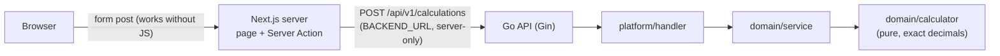

# Sezzle Calculator

Full-stack calculator: a **Go** REST microservice (Gin, layered: pure domain + platform adapters) and a **Next.js 16** (React 19 + TypeScript + Tailwind) frontend that calls it from the server. Interview brief: [`test.md`](test.md).

Operations: add, subtract, multiply, divide, plus the optional power, square root and percentage. Numbers are **exact decimals** end to end (`0.1 + 0.2 = 0.3`).



## Quick start (Docker)

Requirements: Docker with Compose v2.

```bash
git clone <repo-url> sezzle-calculator && cd sezzle-calculator
make up      # builds both images, waits until healthy (≈15 s once cached)
```

Open **http://localhost:3000**. The API is on **http://localhost:8080**.

```bash
make smoke   # real calculations against the running stack (same script CI runs)
make logs    # follow both services
make down
```

Ports taken? `BACKEND_PORT=18080 FRONTEND_PORT=13000 make up` (and the same variables for `make smoke`). Without `make`: `docker compose up --build`.

### Local observability (logs)

Both services write one JSON log line per request (same keys: `time`, `level`, `msg`), tied together by a `request_id` the frontend sends as `X-Request-ID`. An opt-in compose profile ships them to a local Grafana; nothing leaves your machine.

```bash
make up-obs  # the app + Alloy, Loki and Grafana
make smoke   # generate some traffic
make down    # removes everything; logs are not kept
```

| URL | What |
|---|---|
| http://localhost:3001 | Grafana, no login. Explore → Loki |
| http://localhost:12345 | Alloy UI: pipeline components and their health |

```
 frontend ──stdout JSON──┐                         ┌──> loki:3100 ──> grafana :3001
 backend  ──stdout JSON──┴─(docker.sock)─> alloy ──┘    (level label)
```

Useful queries:

- `{service_name=~"backend|frontend"} | json` — everything, fields extracted.
- `{service_name="frontend", level="ERROR"}` — backend calls that failed (`reason`: `network`, `timeout`, `server_error`, `invalid_response`).
- `{service_name="backend"} | json | error_code="division_by_zero"` — API errors by contract code.

Click a `request_id` in any line to see every line of that request in both services. Docker healthcheck hits on `/health` are dropped by Alloy. Ports taken? `GRAFANA_PORT` and `ALLOY_PORT` move them, like `BACKEND_PORT` / `FRONTEND_PORT`. Colima/Podman: point `DOCKER_SOCK` at your Docker socket.

## Local development

Requirements: Go 1.26+, Node 24+, pnpm 11 (`corepack enable`), golangci-lint v2 (for `make lint`).

```bash
make install         # pnpm install + go mod download
make install-hooks   # optional: lefthook git hooks (lint/format on commit, tests on push)
```

Run each service in its own terminal:

```bash
cd backend && make run                                     # API on :8080 (PORT, GIN_MODE env vars)
cd frontend && BACKEND_URL=http://localhost:8080 pnpm dev  # UI on :3000
```

`BACKEND_URL` is required and read only by the Next.js server; copy `frontend/.env.example` to `frontend/.env.local` instead of exporting it if you prefer. A missing or invalid value stops the server at start-up (`src/instrumentation.ts`).

| Command | What it does |
|---|---|
| `make check` | Everything CI checks: backend lint + race tests, frontend lint + format + typecheck + tests |
| `make cover` | Coverage reports: `backend/coverage.html`, `frontend/coverage/index.html` |
| `cd backend && make test` / `make lint` / `make fmt` | Backend only |
| `cd frontend && pnpm test` / `pnpm lint` / `pnpm typecheck` / `pnpm build` | Frontend only |

## API examples

Full contract: [`docs/api/calculator.md`](docs/api/calculator.md). One endpoint does every calculation: `POST /api/v1/calculations` with `{"operation", "operands"}`. Operands may be strings or JSON numbers; results are always strings so no client rounds them through a float. Every output below was produced by the running stack.

```bash
curl -s -X POST localhost:8080/api/v1/calculations \
  -H 'Content-Type: application/json' \
  -d '{"operation":"add","operands":["2","3"]}'
# 200 {"operation":"add","operands":["2","3"],"result":"5"}
```

The other operations, same request shape (`-H 'Content-Type: application/json'` omitted):

| `-d` | Status | Response |
|---|---|---|
| `{"operation":"subtract","operands":["10","4.5"]}` | 200 | `{"operation":"subtract","operands":["10","4.5"],"result":"5.5"}` |
| `{"operation":"multiply","operands":["1.5","4"]}` | 200 | `{"operation":"multiply","operands":["1.5","4"],"result":"6"}` |
| `{"operation":"divide","operands":["1","3"]}` | 200 | `{"operation":"divide","operands":["1","3"],"result":"0.3333333333333333"}` |
| `{"operation":"add","operands":[0.1, 0.2]}` | 200 | `{"operation":"add","operands":["0.1","0.2"],"result":"0.3"}` |
| `{"operation":"power","operands":["2","10"]}` | 200 | `{"operation":"power","operands":["2","10"],"result":"1024"}` |
| `{"operation":"power","operands":["2","-1"]}` | 200 | `{"operation":"power","operands":["2","-1"],"result":"0.5"}` |
| `{"operation":"sqrt","operands":["2"]}` | 200 | `{"operation":"sqrt","operands":["2"],"result":"1.414213562373095"}` |
| `{"operation":"percentage","operands":["12.5","80"]}` | 200 | `{"operation":"percentage","operands":["12.5","80"],"result":"10"}` |

Errors share one envelope, `{"error":{"code","message"}}`; `code` is the stable contract:

| `-d` | Status | Response |
|---|---|---|
| `{"operation":"divide","operands":["10","0"]}` | 422 | `{"error":{"code":"division_by_zero","message":"division by zero is undefined"}}` |
| `{"operation":"sqrt","operands":["-4"]}` | 422 | `{"error":{"code":"negative_square_root","message":"square root of a negative number is undefined"}}` |
| `{"operation":"power","operands":["0","0"]}` | 422 | `{"error":{"code":"undefined_power","message":"power is undefined for these operands"}}` |
| `{"operation":"power","operands":["10","100000"]}` | 422 | `{"error":{"code":"result_too_large","message":"result exceeds the supported size"}}` |
| `{"operation":"add","operands":["a","1"]}` | 400 | `{"error":{"code":"invalid_operand","message":"operand is not a valid decimal number"}}` |
| `{"operation":"add","operands":["1234…(51 digits)","1"]}` | 400 | `{"error":{"code":"operand_too_large","message":"operand exceeds the supported size"}}` |
| `{"operation":"add","operands":["1"]}` | 400 | `{"error":{"code":"invalid_operand_count","message":"wrong number of operands for operation"}}` |
| `{"operation":"modulo","operands":["1","2"]}` | 400 | `{"error":{"code":"unsupported_operation","message":"operation is not supported"}}` |
| `{"operation":"add","operands":[true,"1"]}` or `not json` | 400 | `{"error":{"code":"invalid_request","message":"request body must be a JSON object with an operation string and an operands array of numbers or numeric strings"}}` |

Other routes:

```bash
curl -s localhost:8080/api/v1/operations
# {"operations":[{"name":"add","arity":2,"symbol":"+"},{"name":"subtract","arity":2,"symbol":"−"},{"name":"multiply","arity":2,"symbol":"×"},{"name":"divide","arity":2,"symbol":"÷"},{"name":"power","arity":2,"symbol":"^"},{"name":"sqrt","arity":1,"symbol":"√"},{"name":"percentage","arity":2,"symbol":"%"}]}

curl -s localhost:8080/health
# {"status":"ok","version":"local"}

curl -s -i localhost:8080/api/v1/calculations
# HTTP/1.1 405 Method Not Allowed
# Allow: POST
# {"error":{"code":"method_not_allowed","message":"method not allowed for this route"}}

curl -s localhost:8080/nope
# 404 {"error":{"code":"not_found","message":"route not found"}}
```

## Design decisions and assumptions

**Backend**

- **Layered, domain first.** `internal/domain` (value objects, pure arithmetic, use case, categorised errors) has no Gin, `net/http` or JSON imports; golangci-lint `depguard` fails the build if it does. `internal/platform` holds the adapters (handler, router, middleware, config). The handler calls the concrete `CalculatorService` directly: there is one implementation and no I/O, so an interface would only add indirection. Interfaces arrive with real dependencies (e.g. a history repository). Details: [`docs/ARCHITECTURE.md`](docs/ARCHITECTURE.md).
- **Exact decimals, not `float64`.** `shopspring/decimal` inside the domain, strings on the wire. `float64` would answer `0.1 + 0.2 = 0.30000000000000004`, and JavaScript would round big JSON numbers anyway. Non-terminating results (division, roots, negative/fractional powers) are rounded half away from zero to 16 decimal places.
- **Bounded inputs.** Operands: at most 50 significant digits and exponent within ±1000. `power`: `|exponent|` ≤ 1000 and the result must fit the same limits, checked from an estimate *before* computing, so `10 ^ 100000` is rejected in well under a millisecond. Request bodies are capped at 1 MiB.
- **One calculations endpoint** (`POST /api/v1/calculations`) instead of `/add`, `/divide`, …: one handler, one validation path, and adding an operation touches only the domain registry. `GET /api/v1/operations` exposes that registry.
- **400 vs 422.** 400 when the request is malformed (bad JSON, unknown operation, wrong operand count, not a number); 422 when it is well-formed but mathematically undefined (`10 ÷ 0`, `√-4`, `0 ^ 0`, result too large). The domain only knows error *kinds*; one handler-side mapper turns them into statuses.
- **Percentage** is `a% of b` = `a × b / 100` (`12.5 % 80 = 10`), the common calculator meaning.
- **No complex numbers:** `sqrt` of a negative and fractional powers of negatives are errors.
- Cross-cutting middleware: `X-Request-ID` (echoed or generated), JSON access log (`slog`), panic recovery to the JSON envelope, body limit. 5xx causes are logged with the request ID, never returned.

**Frontend**

- **Server-first Next.js.** The page is a Server Component; the form posts to a **Server Action**, which calls the Go API from `src/lib/api/client.ts` (`server-only`). The browser never calls the backend, so there is **no CORS**, `BACKEND_URL` never reaches the bundle, and the calculator **works with JavaScript disabled**. Only the calculator form is a Client Component.
- **Form, not keypad.** `[number] [operation] [number] [Calculate]` maps 1:1 to the API and needs no client-side expression state. Square root hides the second number.
- **Validation twice, backend decides.** The same parser checks input in the browser (instant inline errors, no request) and again in the Server Action; the Go API stays the final authority.
- **Errors are mapped, never raw.** `src/lib/errors.ts` turns every API `code` into a user message ("You can't divide by zero."), shown in an `aria-live` region next to the related input; inputs are kept. Network failure, timeout (5 s), 5xx and responses that break the contract all become "The calculator service is unavailable. Try again." `error.tsx` and `not-found.tsx` catch the rest.
- **Results are strings to the end.** Grouping (`1,234,567.5`) is done on the string, never through `number` or `Intl.NumberFormat` (which turns `2 ^ 1000` into `∞`); the exact value is in the result's `title`.
- Accessible and responsive: labelled inputs, `aria-invalid` / `aria-describedby`, visible focus, 44 px tap targets, usable at 320 px, light/dark via `prefers-color-scheme`.

**Assumptions / out of scope:** one calculation at a time (no expression parsing like `2+3*4`, no history), no authentication or persistence, English only.

## Testing and coverage

- **Backend** (Go, testify, table-driven, no mocks): unit tests next to the code for domain rules and middleware; **acceptance tests** in `backend/tests/` drive the fully wired router over HTTP, one row per ticket acceptance criterion. Coverage is measured across packages (`-coverpkg=./internal/...`).
- **Frontend** (Vitest + Testing Library): components tested through roles and labels; `fetch` mocked at the `src/lib` boundary; the Server Action tested with the API client mocked.
- **Stack:** `scripts/smoke.sh` runs against `docker compose`: API calculations and a real no-JS form post through the frontend to the backend.

Current numbers (fresh `make cover`):

| | Statements | Branches | Functions | Lines |
|---|---|---|---|---|
| Backend (`internal/...`) | **100%** | — | — | — |
| Frontend (`src/`, 118 tests) | **96.27%** | 94.28% | 97.56% | 96.55% |

Reports: `backend/coverage.html` and `frontend/coverage/index.html` after `make cover`. CI uploads both as artifacts (`backend-coverage`, `frontend-coverage`) and writes the backend summary to the job page.

## CI

GitHub Actions ([`.github/workflows/ci.yml`](.github/workflows/ci.yml)): backend lint, race tests with coverage, `govulncheck`; frontend lint, format, typecheck, tests with coverage, build; a Docker job that builds both images, starts the stack and runs `scripts/smoke.sh`; gitleaks and hadolint. Actions are pinned to commit SHAs and bumped by Dependabot.

## Repository layout

```
backend/      Go API — cmd/main.go, internal/domain (pure), internal/platform (adapters), tests/ (acceptance), Dockerfile
frontend/     Next.js app — src/app (page, Server Action, error/not-found), src/components, src/lib, Dockerfile
scripts/      smoke.sh (stack smoke test)
deploy/local/ Alloy and Grafana config for the local logs stack (`make up-obs`)
docs/         ARCHITECTURE.md, api/calculator.md, tickets/ (the plan), PROMPTS.md (AI prompt ledger)
```

## How this was built (AI usage)

The work was planned as small tickets in [`docs/tickets/`](docs/tickets/README.md) whose acceptance criteria were written as tests first. It was built with Claude Code; every prompt is recorded verbatim, with what came out of it, in [`docs/PROMPTS.md`](docs/PROMPTS.md).
